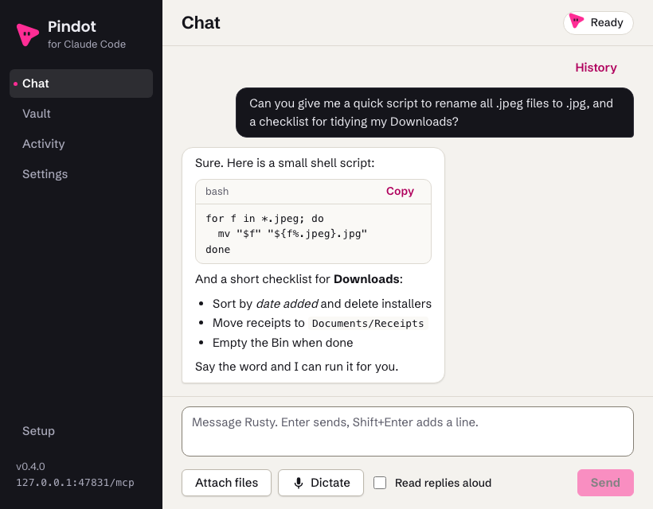

<p align="center">
  <picture>
    <source media="(prefers-color-scheme: dark)" srcset="docs/brand/pindot-lockup-colour-on-dark.svg">
    
  </picture>
</p>

# Pindot

Hold a key, say what you want, and your assistant does it on your computer
and answers out loud. Or type it in the chat window.

Pindot gives the Claude Code you already use eyes, hands and a voice. It can
see your screen, open apps, click, type and scroll, and it shows you every
move with its own on-screen cursor, Rusty. Ask it to do something and it
does it; ask "show me how" and it points the way instead.

<p align="center">
  <picture>
    <source media="(prefers-color-scheme: dark)" srcset="docs/ui-pass/design/dark/chat-conversation.png">
    
  </picture>
</p>

Pindot is free and open source (MIT). It is an independent project, not made
by, endorsed by or affiliated with Anthropic. "Claude" and "Claude Code" are
Anthropic's names for their products.

> **Early release (0.0.1).** Tested on macOS 26 on Apple silicon, and on one
> Windows 11 PC with a handful of apps. There is no ready-made download yet:
> you build it yourself (see [Install](#install)).

## What you can do

- **Talk to it.** Hold the hold-to-talk key, speak, let go. Rusty answers out
  loud and, if you like, in a caption bubble beside the cursor.
- **Type to it.** The Chat window is the same conversation as the voice. Drop
  in files or pictures to share them.
- **Dictate.** Speak into the chat box instead of typing; nothing is sent
  until you press Send.
- **Let it work.** "Open TextEdit and write a shopping list", "find the
  unread email from Sam", "turn on dark mode". Rusty glides to each button
  before it clicks, so you always see what it is doing.
- **Learn from it.** "Show me how to change my wallpaper" makes Rusty point
  and explain one step at a time without clicking anything.
- **Sign in for you, without seeing your password.** Save a login in the
  Vault and Rusty can type it into the right website for you.
- **Give it your notes.** Point it at a folder of notes and it can look
  things up there and remember what you ask it to.
- **Stream or record it.** Streaming mode lets OBS and screen shares show
  Rusty's cursor and captions.
- **Use it from your terminal.** One button connects Pindot's desktop tools
  to Claude Code in your own terminal.

## What you need

- A Mac with macOS 13 or later (Apple silicon tested), or Windows 11.
- [Claude Code](https://github.com/anthropics/claude-code), installed and
  signed in. Run `claude login` once in a terminal. On Windows, install the
  native app (`claude.exe`), not the npm package.
- A Claude plan that includes Claude Code. Pindot uses Claude Code just like
  you do in a terminal, so it counts against the same usage limits. It never
  asks for an API key.
- About 231 MB of disk for the voice models, downloaded once during setup.
  Chat works without them.

## Install

Pindot isn't available as a download yet, so you build it from the source.
The first build takes a while: it compiles everything and downloads ONNX
Runtime (about 150 MB).

**macOS.** Install the Xcode command line tools (`xcode-select --install`),
[Rust](https://rustup.rs) and [Node.js](https://nodejs.org) 22 or later, then:

```sh
git clone https://github.com/projectservan8n/pindot.git
cd pindot/app
npm ci
npx tauri build
```

Open `target/release/bundle/dmg/` (in the `pindot` folder) and drag Pindot to
Applications. If you rebuild later, macOS may ask for Pindot's permissions
again.

**Windows.** Install [Rust](https://rustup.rs) (the MSVC toolchain),
[Node.js](https://nodejs.org) and the Visual Studio 2022 C++ build tools.
Then, in PowerShell:

```powershell
git clone https://github.com/projectservan8n/pindot.git
cd pindot
scripts\build-windows.ps1
```

Run the installer it makes:
`target\release\bundle\nsis\Pindot_<version>_x64-setup.exe`. It installs for
your user only and needs no administrator rights.

## First start

Pindot lives in the menu bar (the taskbar's hidden icons on Windows); there
is no Dock icon. The first time, it opens **Setup**, which walks you through:

1. **Claude Code**: found and signed in. If not, run `claude login` in a
   terminal and press Check again.
2. **Permissions** (macOS, below).
3. **Voice models**: about 231 MB. You see each license before anything
   downloads. A stopped download picks up where it left off.
4. **Finish**: Pindot opens the Chat window, and hold-to-talk starts once
   everything it needs is in place.

You can come back to Setup at any time from the menu-bar icon.

### macOS permissions

| Permission | What Pindot uses it for |
|---|---|
| Accessibility | Reading windows, clicking, typing, and the Esc stop key |
| Input Monitoring | Noticing the hold-to-talk key and Esc |
| Screen Recording | Taking screenshots when it needs to look |
| Microphone | Hearing you while you hold the key |

Setup shows which ones are on. "Ask macOS" brings up the system prompt;
"Open System Settings" takes you to the right list, where you switch Pindot
on. Some permissions take effect only after Pindot restarts.

On Windows nothing needs granting, except that the microphone switches under
Settings > Privacy & security > Microphone must be on.

## Using Pindot

### Talk

Hold **Fn** (macOS) or **Ctrl+Win** (Windows), say what you want, and let go.
A small pill near the top of the screen shows Listening, Thinking, Working
and Speaking.

- Hold the key again while Rusty is speaking to cut him off and talk.
- Or tap the key once to talk hands-free, and tap again to send.
- Holding Fn never triggers the Globe key's own action.
- You can change the key in Settings: one to four modifier keys, such as
  Right Option or Ctrl+Cmd.

### Chat

The Chat window is the same conversation as the voice, so you can switch
between typing and talking. Typed messages are answered on screen; tick
**Read replies aloud** to hear them too. Drag files or pictures onto the
window, paste them, or use **Attach files**. Each step Rusty takes shows as a
short line you can expand. Earlier conversations are under **History**
(read only for now).

### Dictate

Press **Dictate** beside Attach files, speak, and press it again. Your words
land in the message box, ready to edit; nothing is sent until you press Send.
While the message box has focus, holding the hold-to-talk key dictates
instead of sending a spoken request. **Esc** cancels.

### Approving apps

Rusty can touch only the apps you allow. The first time he needs an app, a
window asks you, with his reason. Nothing happens until you press **Allow
for this session**; no answer within two minutes counts as Deny. Terminals,
code editors, file managers, system settings and password managers come with
an extra red warning, because access to them is close to full control of
your computer.

### Stop

Press **Esc** at any time. It stops what Rusty is doing, stops him speaking
and ends his turn. While he is working, a banner across the top of the screen
says so: "Rusty is controlling input · press Esc to stop".

### Saved logins (Vault)

Save a login under **Vault** (website, username, password and, optionally,
an authenticator key), or import a CSV exported from Chrome, 1Password or
Bitwarden. When Rusty needs to sign in, Pindot types the login itself.
Claude only ever sees the login's name and website, never the password.

Pindot types a saved login only when all of these hold:

- you approved that login for this session in Pindot's own window (every
  login asks separately);
- the browser in front (Safari, Chrome, Edge, Brave, Chromium, Vivaldi, Arc
  or Opera) shows exactly the saved website address;
- a password goes into a password field;
- fewer than five fills in the last minute, with fills paused after three
  refusals.

Every fill and every refusal is listed in the Vault and in Activity.
Passwords are encrypted, and the key is kept in the macOS Keychain or the
Windows Credential Manager, never in a file. There is no button that reveals
a saved password; your password manager already has it.

What the Vault does **not** protect against: a hacked page at the right
address, a keylogger or screen recorder on your computer, or someone using
your unlocked account. Firefox, app (non-browser) logins and payment cards
are not supported. Delete an imported CSV afterwards: it isn't encrypted.

### Brain folder

Settings > Brain folder lets Rusty use a folder of notes, or a Claude Code
project. He reads its `CLAUDE.md`, opens only the notes a request needs, and
can write only inside a `pindot-notes/` folder in it, for things you ask him
to remember. Pick a folder you trust: its own Claude settings apply.

### Streaming and recording

Normally Rusty's cursor is invisible to screen recorders. Turn on
**Streaming mode** in Settings to show his cursor and captions in OBS and
screen shares. The Pindot window, the Vault and approval windows stay hidden
from viewers either way. Needs macOS 14 or later.

### From Claude Code in your terminal

Settings > "Claude Code in your terminal" > **Connect** adds Pindot's desktop
tools to Claude Code in your terminal, so any `claude` session can use them
while Pindot is running. **Disconnect** removes them. Only one terminal
session should use them at a time: they share app approvals.

## Settings

Open Settings from the menu-bar icon.

- **Assistant**: the name (Rusty by default), how he talks to you (friendly,
  brief, professional or playful) and your own words on it ("Call me Sam").
  Your words change his tone only, never his safety rules.
- **On-screen cursor**: its colour, whether it stays beside your pointer
  while you talk, and the caption bubble.
- **Hold-to-talk**: the key and tap-to-talk.
- **Listening and Speaking**: the microphone, the speech models, the voice
  (37 to choose from), the volume, and whether to speak every message or only
  the last one.
- **Claude**: the model, how hard it thinks, and permissions. **Ask**
  (recommended) lets Claude use only Pindot's desktop tools. **Auto** also lets
  it run commands, change files and browse the web, as you; read the warning
  before you turn it on.
- **Streaming mode**, the **Brain folder** and the terminal connection, as
  above.

## Your privacy

- **Your voice stays on your computer.** Speech is turned into text on your
  machine and never saved. The spoken replies are made on your machine too.
- **What Claude sees goes to Anthropic.** When Rusty reads a window, takes a
  screenshot, or opens a file you attached or a note in your brain folder,
  that goes to Claude through your own Claude Code, exactly as if you used
  Claude Code yourself. Screenshots grey out every app you haven't approved.
- **Pindot has no server, no account and no telemetry.** Its only other
  network traffic is downloading the voice models, from Hugging Face (with
  a mirror as a fallback), when you ask for them.
- **Everything Pindot keeps is on your computer**, readable by you only:
  settings, the activity log, the voice models and the encrypted Vault.
  Claude Code keeps its own transcripts of the conversations under
  `~/.claude/projects/`.
- **Activity** (in the Pindot window) lists every action Rusty took. You can
  filter it or clear it.

## Troubleshooting

- **"Claude Code is not signed in"**: run `claude login` in a terminal, then
  Setup > Check again.
- **Hold-to-talk does nothing**: the status pill and Setup say what is
  missing (a permission, the voice models, Claude Code). After granting
  Input Monitoring or Accessibility, quit and reopen Pindot.
- **Rusty says an app is not allowed**: answer the approval window when it
  appears. Pindot's own windows are never controllable.
- **"The connection Claude Code uses is not running"**: another program uses
  Pindot's port (47823). Change the port in Settings > MCP server, restart
  Pindot, then press Connect again if you use the terminal connection.
- **Terminal Claude Code can't reach the desktop tools**: make sure Pindot is
  running, and press Connect again after changing the port or the token.
- **A voice model looks damaged**: Setup > Voice models > Check files checks
  every file and downloads a bad one again.
- **Windows: Rusty can't click in a window**: Windows doesn't let normal apps
  control a window running as administrator. Pindot says so instead of
  clicking.
- **To see Pindot's log (macOS)**: quit Pindot and start
  `/Applications/Pindot.app/Contents/MacOS/pindot` from a terminal.

## Building, testing and contributing

See [docs/development.md](docs/development.md) for how Pindot works inside,
building from source in detail, the developer tools and tests, and
[CONTRIBUTING.md](CONTRIBUTING.md) before you open a pull request.

## License

MIT, see [`LICENSE`](LICENSE). The speech models and their licenses are
listed in [`NOTICE`](NOTICE). The interface fonts, Schibsted Grotesk and
Poppins SemiBold, are bundled under the SIL Open Font License 1.1
(`app/src/fonts/OFL.txt`).
